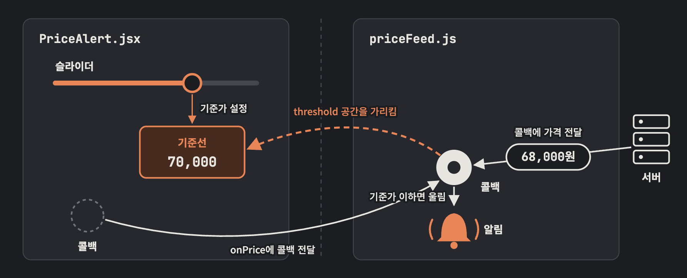

## 클로저에 대해 정확히 아시나요

개발자라면 클로저에 대해 수없이 많이 들어봤을 것이다. 함수가 선언된 스코프를 기억하는 것. 나도 JS Deep Dive 책을 통해 공부하며 읽고, 논의를 하면서도 많이 들었다.
뭔지는 알겠는데 그게 왜 필요한지, 어디서 사용되는지가 와닿지 않아서 확실하게 안다고 말하기 어려웠는데, 일하다가 사용되는 사례를 알게되어 자세히 공부해보았다.

TL;DR

> 클로저가 들고 다니는 건 값이 아니라 공간이다.
> React는 렌더마다 새 공간을 만든다.
> deps 배열은 "새 공간을 가리키는 함수로 갈아끼워라"는 뜻이다.

---

## 매개변수로 받지 않은 외부 값에 함수가 접근할 수 있다고?

아래는 예시를 위한 코드이다. 서버가 시세를 보내 주면, 내가 슬라이더로 정한 기준가보다 낮을 때 알림을 울린다.

```js
// priceFeed.js — 시세 구독 모듈
let listener;
export function onPrice(fn) {
  listener = fn;
}

// 서버에서 시세가 올 때마다 가격만 넘긴다.
listener(price);
```

```jsx
// PriceAlert.jsx
function PriceAlert() {
  const [threshold, setThreshold] = useState(70000);

  useEffect(() => {
    onPrice((price) => {
      if (price <= threshold) notify("기준가 도달");
    });
  }, [threshold]);

  return <input type="range" value={threshold} onChange={(e) => setThreshold(+e.target.value)} />;
}
```

priceFeed 쪽은 `threshold`를 모른다. 매개변수로 받지도 않는다. PriceAlert의 로컬 상태이므로 props나 인자로 넘기지 않는 한 접근할 수 없어야 한다. 그런데 비교가 되고, 의도한 대로 동작한다.



---

## 함수는 선언된 자리의 변수를 가리킨 채 떠난다

함수는 선언된 자리의 변수를 가리킨 채로 어디든 넘어간다. 값을 복사해 담아 가는 게 아니라 변수가 있는 공간 자체를 가리킨다. 이렇게 선언된 자리의 변수를 가리킨 채 다니는 함수를 클로저라고 한다.

```js
let count = 0;
const read = () => count;
count = 1;
read(); // 1, 복사였다면 0
```

read가 생성될 당시 count의 값을 복사해갔다면 `read()`는 0을 돌려줬을 것이다. 1이 나오는 건 `read`가 `count`라는 공간을 가리키고 있다가, 호출될 때 그 안을 읽기 때문이다.

위 그림의 주황 점선이 이 부분이다. 콜백은 `threshold` 공간을 가리킨 채 priceFeed로 넘어갔고, 거기서 호출돼도 그 공간을 열어 기준가를 읽는다.

---

## 그럼 메모리 항상 잡고있는 거 아님?

잡고 있다. 그 함수가 살아 있는 동안만
JS의 가비지 컬렉터는 아무도 가리키지 않는 것을 치운다. 콜백이 listener에 들어 있는 동안에는 콜백도, 콜백이 가리키는 공간도 남는다.
listener에서 콜백이 빠지거나 다른 콜백으로 바뀌면 둘 다 치울 수 있게 된다.

---

## React에서는 왜 옛 기준가로 울릴까

deps를 `[]`로 바꿔 보자.

```jsx
useEffect(() => {
  onPrice((price) => {
    if (price <= threshold) notify("기준가 도달");
  });
}, []);
```

슬라이더를 50,000으로 내려도 가격이 60,000이면 알림이 울린다.

함수 컴포넌트는 렌더마다 처음부터 다시 실행된다. 그래서 `threshold`도 렌더마다 새로 만들어진다. 70,000이 담긴 첫 렌더의 공간과 50,000이 담긴 다음 렌더의 공간이 따로 있다.

deps가 `[]`이면 effect는 첫 렌더에서 한 번만 돈다. listener에는 첫 렌더에서 만든 콜백이 남고, 그 콜백은 첫 렌더의 공간을 가리킨다. 그 공간의 값은 끝까지 70,000이다.

복사해서 옛 값이 나오는 게 아니라, 옛 공간을 가리키고 있어서 옛 값이 나오는 것

---

## deps 배열은 "갈아끼워라"는 뜻이다

원래 코드처럼 deps에 `threshold`를 넣으면 값이 바뀔 때마다 effect가 다시 돈다. 그 렌더의 공간을 가리키는 새 콜백이 만들어져 listener에 등록된다.

**"그럼 콜백이 렌더마다 계속 쌓이는 거 아닌가요!?"**

이 예시에서는 안 쌓인다. listener가 하나라 새 콜백이 옛 콜백을 덮어쓴다. 아무도 가리키지 않게 된 옛 콜백은 앞에서 말한 대로 가비지 컬렉터가 치운다.

하지만 실제 구독 모듈은 콜백을 여러 개 받는 경우가 많아서, 적절하게 처리해주지 않으면 계속 쌓일 수 있다.

```js
export function onPrice(fn) {
  listener = fn;
  return () => {
    if (listener === fn) listener = null;
  };
}
```

```jsx
useEffect(() => {
  return onPrice((price) => {
    if (price <= threshold) notify("기준가 도달");
  });
}, [threshold]);
```

React는 effect를 다시 돌리기 전에, 그리고 컴포넌트가 사라질 때 이 해제 함수를 부른다. 해제 함수도 `fn`을 가리키는 클로저라서, 나중에 불려도 그때 등록한 바로 그 콜백을 떼어낼 수 있다. 떼지 않으면 컴포넌트가 사라진 뒤에도 콜백이 남아 알림을 울리고, 앞에서 말한 공간도 치워지지 않는다.

---

## 정리

- 클로저는 값을 복사하지 않고, 변수가 있는 공간을 가리킨다.
- React는 렌더마다 새 공간을 만든다. 옛 함수는 옛 공간을 본다.
- deps 배열은 새 공간을 가리키는 함수로 갈아끼우라는 신호다.

```toc
```
